# gestion-academica-web — Clase práctica React (Semana 10)

Frontend **React + TypeScript + Vite + Tailwind** del proyecto de grupo *Gestión Académica* (Servicios Web, UAM).
Parte de la base `gestion-academica-web` entregada en clase y aplica la guía *“React desde cero hasta consumo de APIs”*: componentes con props, `useState`, `useEffect` con `AbortController` y **Axios** consumiendo la API de Spring Boot.

El dominio es el **Test de Valores de Allport**. El backend es el del repositorio
[`servicios-web-sesion8-dto-paginacion-allport`](https://github.com/Rrodrovan/servicios-web-sesion8-dto-paginacion-allport) (carpeta `backend/`, puerto **9090**).

## Ejecutar

1. Levantar el backend Spring Boot (`AllportApiApplication`, PostgreSQL `allport_db`) → `http://localhost:9090/api/v1/resultados`.
2. En esta carpeta:

```bash
npm install        # o pnpm install
npm run dev        # http://localhost:5173
```

- `VITE_API_BASE_URL=/api/v1` (`.env.development`) es la URL base de Axios.
- El **proxy de Vite** (`vite.config.ts`) reenvía `/api` a `http://localhost:9090`; el navegador habla con el mismo origen (5173), así que en desarrollo no hay problema de CORS. El backend además permite `http://localhost:5173` en su `CorsConfig`.

## Estructura

```
src/
  App.tsx                                  Encabezado y página
  shared/config/env.ts                     URL base desde variables de entorno
  shared/api/httpClient.ts                 Instancia Axios (baseURL, timeout 8000) + ApiError + interceptor
  shared/api/types.ts                      Formato de error del backend
  features/resultados/
    types.ts                               Tipos del contrato (Resultado, ResultadoNuevo, Pagina)
    resultadosApi.ts                       GET paginado y POST (módulo de servicios, sin componentes)
    useResultados.ts                       useEffect + AbortController, cargando / error / reintentar
    calculos.ts                            Filtro combinado, normalización de texto, porcentaje seguro
    ResultadosPage.tsx                     Composición: formulario, indicadores, filtros y lista
    components/ResultadoCard.tsx           Tarjeta (props)
    components/Filtros.tsx                 Búsqueda + carrera + valor dominante (componente controlado)
    components/Indicadores.tsx             Totales y porcentajes por valor dominante
    components/ResultadoForm.tsx           POST con validación y sin envíos duplicados
    components/EstadoError.tsx             Error controlado con botón Reintentar
```

## Endpoints consumidos

| Método | Ruta | Uso |
|---|---|---|
| GET | `/api/v1/resultados?page=0&size=50&sort=id,asc` | Lista paginada; el cliente recorre las páginas hasta `last = true` |
| POST | `/api/v1/resultados` | Registra un resultado; responde **201** con el recurso creado |

## Retos

Las respuestas razonadas y las decisiones de cada reto están en [`REFLEXION.md`](REFLEXION.md).

| Reto | Estado | Dónde |
|---|---|---|
| 1 · Filtro combinado (carrera + valor dominante, caso sin coincidencias) | ✅ | `calculos.ts`, `Filtros.tsx` |
| 2 · Indicadores operativos (total y % por valor, sin dividir entre cero, arreglo vacío) | ✅ | `Indicadores.tsx` |
| 3 · Búsqueda robusta (sin mayúsculas ni tildes, botón Limpiar) | ✅ | `calculos.ts`, `Filtros.tsx` |
| 4 · Registro real mediante POST | ✅ | `ResultadoForm.tsx`, `resultadosApi.ts` |
| 5 · Diseño y resiliencia (componentes, servicios, Reintentar, accesibilidad) | ✅ | `useResultados.ts`, `EstadoError.tsx` |

## Evidencias

Capturas tomadas con el backend real (Spring Boot + PostgreSQL, puerto 9090) y el frontend en `http://localhost:5173`.

| # | Evidencia | Captura |
|---|---|---|
| 1 | React en el navegador: lista obtenida con Axios (GET), indicadores y filtros | 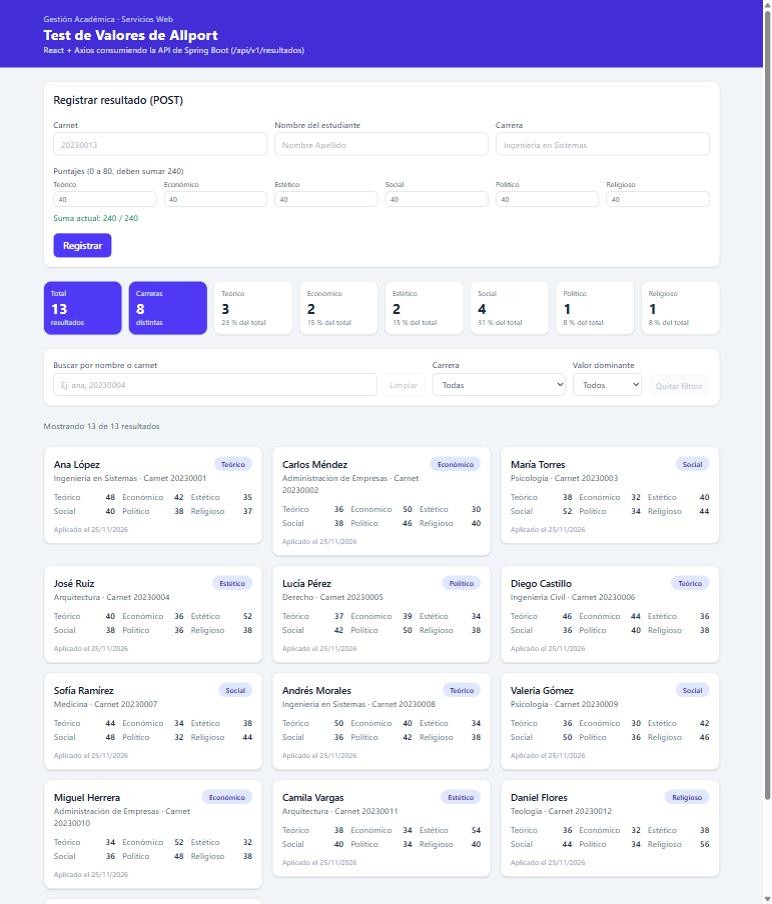 |
| 2 | Reto 1 · Filtro combinado: carrera *Ingeniería en Sistemas* + valor *Teórico* → 2 de 13 | 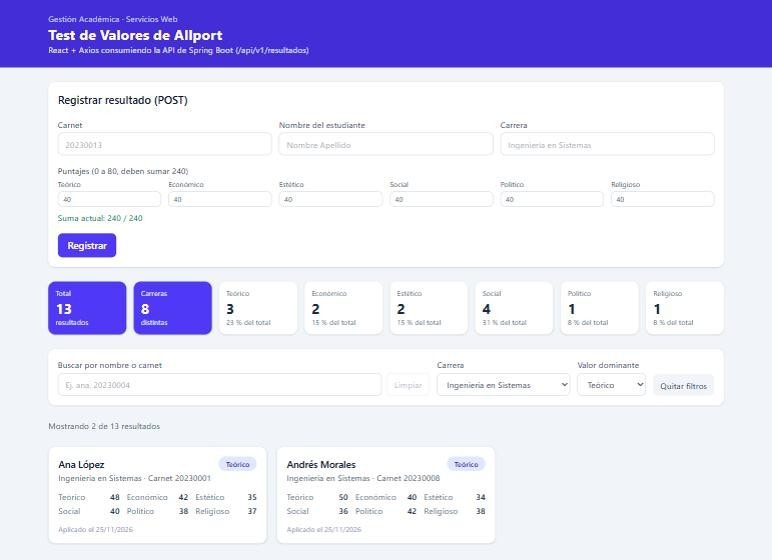 |
| 3 | Reto 1 · Caso sin coincidencias (*Teología* + *Social*) | 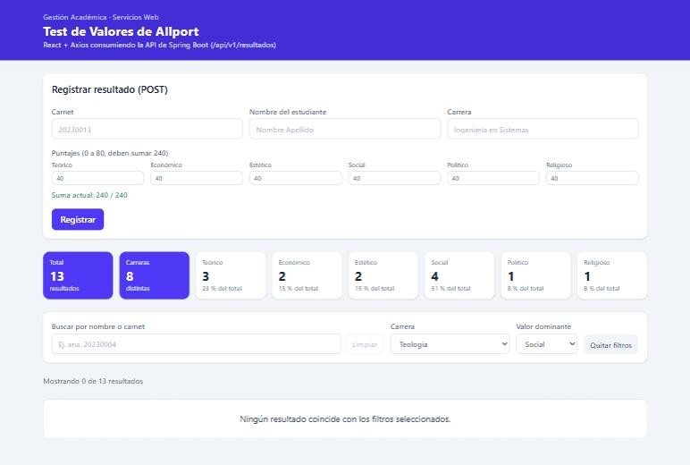 |
| 4 | Reto 3 · Búsqueda sin mayúsculas ni tildes: `JOSE` encuentra a *José Ruiz* | 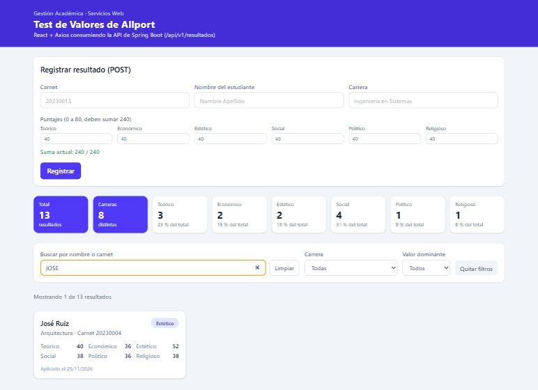 |
| 5 | Reto 4 · Validación en el cliente antes de enviar (carnet inválido, suma 260) | 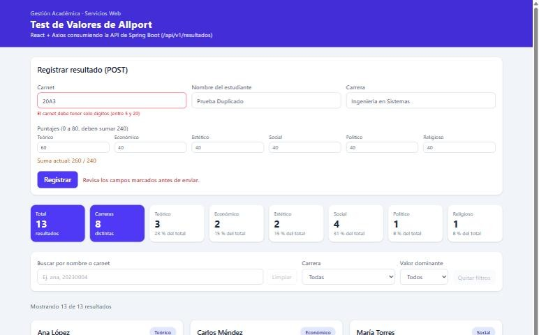 |
| 6 | Reto 4 · POST con carnet repetido → **409 Conflict** con el mensaje del servidor | 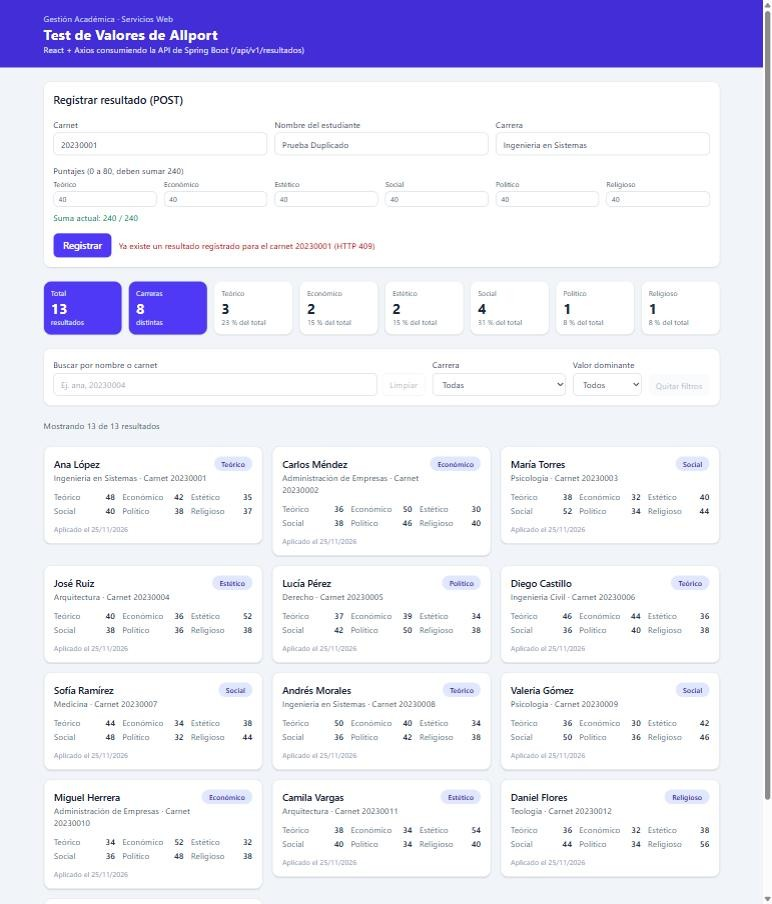 |
| 7 | Reto 4 · POST válido → **201 Created**; la lista y los indicadores se actualizan (14) | 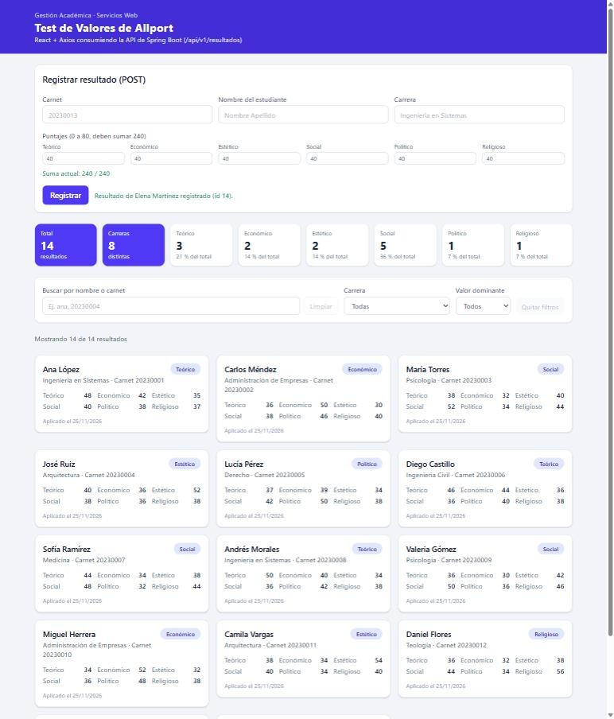 |
| 8 | Respuesta del GET en Postman (`/api/v1/resultados?page=0&size=5&sort=id,asc` → 200 OK) | 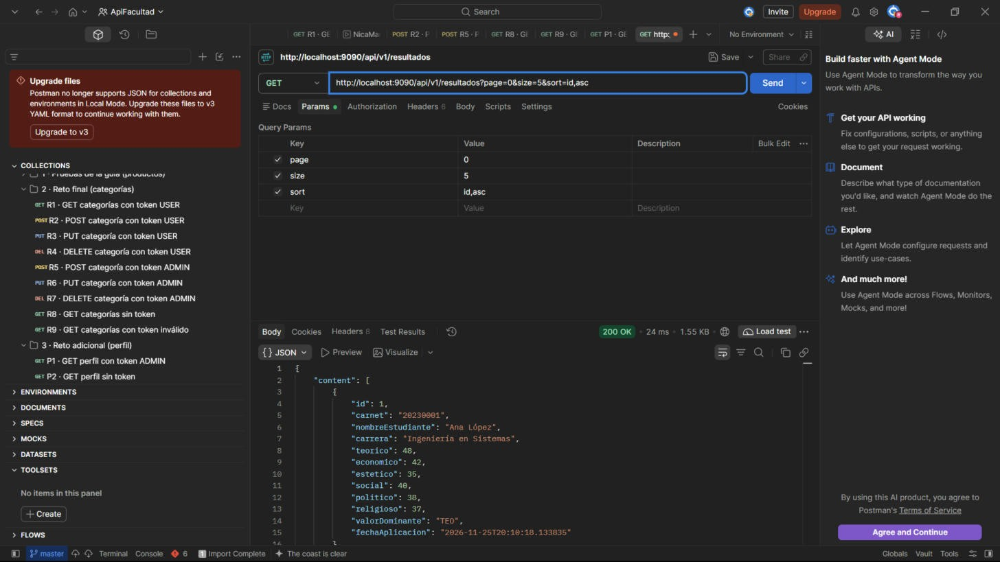 |
| 9 | **Error controlado**: Spring Boot detenido → mensaje claro y botón *Reintentar* | 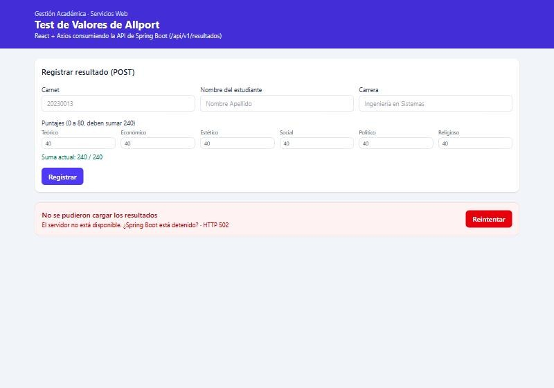 |
| 10 | Reto 5 · Indicador de carga al reintentar | 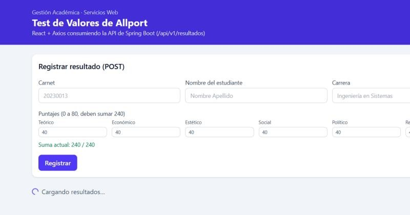 |
| 11 | Reto 5 · Con el backend levantado de nuevo, *Reintentar* recupera los datos | 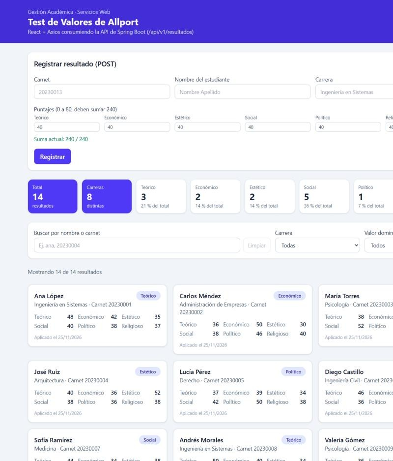 |
